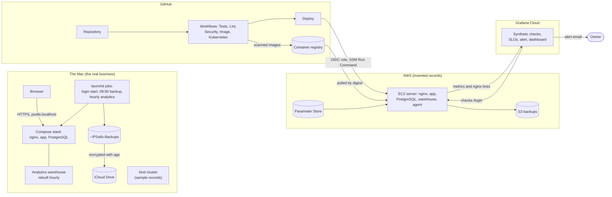

# PSells

The inventory and profit system I run my reselling business on, used from a
browser or from the terminal, and built one layer at a time as a DevOps,
cloud and SRE portfolio: from a Python program that replaced a spreadsheet to
containers, HTTPS, CI that ships to AWS, monitoring against service level
objectives, Kubernetes, and an analytics warehouse.

The real business runs on a Mac. A copy holding invented records only runs on
AWS at `https://psells.lakeshorefreight.me`: log in as `demo`, password
`psells-demo-visitor`, and change anything you like; it puts itself back
every night.

## What it covers

- **The business.** Products held, sales, stock returned to the supplying
  partner and payouts to that partner, each item's partner cut from a rule
  of its own, and a live dashboard of stock, revenue, profit and the balance
  owed. The web pages, the terminal application and the HTTP API call the
  same functions, so they always agree. A sale keeps its own figures, and a
  correction keeps the record as it was in a log that only grows.
- **Running it on the Mac.** nginx, the application and PostgreSQL in
  containers under Compose, served over HTTPS from a certificate authority of
  its own, behind a login. It starts at login, backs itself up every morning
  and proves each backup restores, keeps an encrypted copy off the Mac, and
  shows a notification when a job fails or a certificate nears its end.
- **CI and delivery.** Five workflows on every push: the tests against a real
  PostgreSQL, lint for the shell scripts, nginx and Terraform, a dependency
  audit and a secret scan of the whole history, the images built for two
  architectures and scanned, and the Kubernetes manifests deployed to a
  throwaway cluster. A push to `main` that passes them ships to AWS, with no
  stored keys.
- **The cloud.** The AWS server is described in Terraform and rebuilt from
  it, with a managed database and a load balancer behind a switch.
- **Reliability.** The demonstration is monitored from outside and inside
  against two service level objectives, with one alert and a dashboard, all
  in code, and a deliberate outage was written up as a
  [postmortem](postmortems/2026-10-05-demo-database-stopped.md).
- **Kubernetes.** The same images run on a local cluster from the manifests
  in `k8s/`.
- **Analytics.** An ETL builds a star-schema warehouse from the records, checked
  against the dashboard before it commits; SQL views answer the business
  questions, on a page with charts drawn on the server, refreshed hourly.

## How it fits together

The real business on the Mac, the pipeline on GitHub, and the demonstration
on AWS watched from Grafana Cloud. [ARCHITECTURE.md](ARCHITECTURE.md) has this
and seven more diagrams, each part in detail.

## Where to read next

- [ARCHITECTURE.md](ARCHITECTURE.md): how the whole system fits together, with
  diagrams.
- [RUNBOOK.md](RUNBOOK.md): what to do, from everyday tasks to incidents and
  rebuilding from nothing.
- [DECISIONS.md](DECISIONS.md): why each part is the way it is, indexed by
  area.
- [DATA_MODEL.md](DATA_MODEL.md): what the data means.
- The rest of this file: running it, using it, each part in a few lines, the
  tests, and the known limitations.

Every figure that can be derived is computed when it is asked for, never
stored, so no total can drift from the records it came from. A sale keeps the
figures it was made with, so editing a product never rewrites history. Money
is a whole number of cents everywhere, the HTTP API included.

## Running it

Docker with Compose, and for the tests Python 3 with
`pip install -r requirements-dev.txt`. Settings, the database password
included, live in `.env`, which git and every image leave out:

    cp .env.example .env
    openssl rand -hex 24      # paste as POSTGRES_PASSWORD, and point PSELLS_CONFIG_FILE at the configuration

The first time, make the HTTPS certificate and trust its CA (see "The
certificate" below), then start the stack and create the one account; the
password is at least fifteen characters:

    ./make-certificate.sh
    docker compose up --build -d --wait
    docker compose exec app python set_password.py

Then `https://psells.localhost/`. The terminal application runs in the same
container, against the same database:

    docker compose exec app python psells.py

`docker compose down` stops the stack and keeps the records. The records are
in the `psells_pgdata` volume and the photos in `psells_photos`; never
`docker compose down -v` on the real stack, which deletes both. To try anything on invented records instead, use
the sample stack in [RUNBOOK.md](RUNBOOK.md), "Try something on the sample
stack". The sample business, about 80 products and a year of sales, is
written by `sample_data/generate_seed.py` with the application's own rules,
and a test fails if `seed.sql` is edited by hand.

## Using it

**The web pages**, behind a login:

- **Inventory**, the home page: the nine dashboard figures and the products
  with at least one unit available, with a search by name or category.
  **Out of stock** lists the rest, each with the reason it ran out; every
  product is on exactly one of the two.
- **Pipeline**: how many items are at each stage (Received, Researched,
  Photographed, Listed, Sold, Returned), and the items still being worked
  on under their stage, oldest first, flagged when not worth listing.
- **Sales**, **Returns** and **Payments**: every record, newest first, with
  **Edit** and **Delete** to correct one entered wrongly. A sale keeps its
  frozen figures, and every correction is kept, as the record was, in the
  `corrections` log.
- **Add product** (only the category, name and quantity at first; the
  research and the listed price can follow with **Edit**), **Record
  payment**, and **Sell**, **Return** and **Edit**
  from each product's row. **Edit** shows the partner payout and the profit
  at the Marketplace price, and an item whose profit is under the minimum in
  `data/config.json` (`minimum_listing_profit_cents`) reads **Not worth
  listing** there and beside its name in the inventory. **Edit** also holds the
  item's photos: upload up to ten at a time, from a phone or a computer,
  see them, and delete one.
- **Analytics**: headline figures, revenue and profit by month, categories
  and products, as charts drawn on the server, since no page runs a script.
- **Settings**: the category and condition lists (add, rename, hide, or
  delete one no product has) and the Facebook and Instagram listing
  templates.

The pages call the same functions as the terminal application and the API
and do no arithmetic of their own; tests compare all three, and a test parses
every template to keep it so. A login lasts until two hours without a
request, or twelve in all; the password is stored as an Argon2id hash and
the session as a hash of the cookie's value. Every write carries a
per-session form token and is refused when the browser labels it as coming
from another site.

**The terminal application** has the same features as numbered menu items,
from the dashboard to fixing a sale, return or payment.

**The HTTP API**, `api.py`, serves the same data, in cents, behind the same
login. `/openapi.json` describes every endpoint:

    GET  /products, /products/in-stock, /products/out-of-stock, /dashboard
    GET  /sales, /returns, /payments          every record, newest first
    POST /sales                               record a sale
    PUT, DELETE /sales/{id}, /returns/{id}, /payments/{id}
    GET  /session                             the session's form token, for a write

A write sends the token in an `X-Form-Token` header.

## How it runs

**On the Mac.** Three containers under Compose: nginx, the only one that
publishes ports, on the loopback only; the application, FastAPI under uvicorn,
which publishes none; and PostgreSQL 18, which publishes none either. nginx
answers for `psells.localhost` alone, TLS 1.3 only, and sets the security
headers on every response: a content security policy allowing no script and
only the one style block, by its hash. The application believes forwarded
headers from nginx's fixed address alone. Every image and action is pinned
to its digest or commit, and Dependabot proposes each update. Other devices
(phones, a second laptop) reach it through [Tailscale](https://tailscale.com):
only the tailnet's members, with Tailscale's own certificate, while the Mac
is on, and nothing answers on any Wi-Fi; saved to a home screen, it shows
the PSells logo. Details:
[ARCHITECTURE.md](ARCHITECTURE.md), "The Mac's stack".

**Three background jobs** (launchd): the stack started at login; a backup at
09:00 that restores each dump into a throwaway database and counts it before
keeping it, copies it to iCloud Drive encrypted with
[age](https://age-encryption.org) and decrypts that copy to prove it,
archives the items' photos the same way when they have changed, and checks
the certificates; and the analytics rebuilt every hour. Each shows a
notification when it fails. Installing them, and every procedure, is in
[RUNBOOK.md](RUNBOOK.md).

**The certificate.** `make-certificate.sh` makes a certificate authority of
PSells' own, in `~/PSells-CA`, limited by a name constraint to
`psells.localhost` and no IP address, and signs a 397-day certificate with it
into `data/tls/`. The script prints the one command that makes macOS trust
the CA. Renewing is running it again; the morning backup warns a month ahead.

**The demonstration on AWS.** One small EC2 server in Montreal, on AWS's free
plan, with invented records only: no SSH (Session Manager instead), no
long-lived keys, secrets in Parameter Store, a Let's Encrypt certificate,
backups to S3 proved like the Mac's, and its records put back from the seed
every night, since its login is public. It is described in Terraform in
`infra/aws/` and rebuilt from it in about ten minutes. A managed database
(RDS) and a load balancer are in the same Terraform behind a switch, off
since Phase 09 to stay free.

**Shipping.** A push to `main` that passes all five checks deploys itself:
CI builds and scans the images on both architectures, publishes the scanned
ones, and deploys through AWS's OpenID Connect and one SSM document that can
do nothing else, then confirms the server runs that exact image. Rolling
back is the same workflow on an earlier commit.

**Monitoring.** The demo only, on Grafana Cloud's free tier, all in
Terraform in `infra/grafana/`: checks of the login page from three places
every two minutes, an agent sending the server's health and nginx's lines,
two service level objectives over seven days (99.5% of checks pass, 99% of
requests under 500 ms), one alert, and a dashboard. A deliberate outage is
written up in [postmortems/](postmortems/2026-10-05-demo-database-stopped.md).

**Kubernetes.** The same images on a local kind cluster from the manifests in
`k8s/`, with the invented records, at `https://psells.localhost:9443`:
`k8s/up.sh` builds or updates it, `k8s/down.sh` removes it. CI builds the
same cluster from nothing on every push and checks it from outside.

**Analytics.** An ETL, `analytics/etl.py`, rebuilds a star-schema warehouse,
a second PostgreSQL, from the business records every hour, reading as a
read-only role through psells' own functions and committing only if it adds
up to the dashboard. SQL views over it (`analytics/views.sql`) answer the
business questions, and the analytics page reads them as a role that can
read nothing else.

## Running the tests

Against a real PostgreSQL, `db-test`, which holds invented rows only:

    docker compose --profile test up -d --wait db-test
    pytest

The suite builds its tables from `schema.sql` on every run and rolls each
test back, so tests never share rows, and every warning is an error. A test
that has never been seen failing is not trusted: each was broken on purpose
first. The files, one concern each:

| File | Holds |
|---|---|
| `test_domain.py` | the calculations: partner share, stock, dashboard, money, every write's rules |
| `test_features.py` | the terminal application's menu functions, end to end |
| `test_history.py` | the stock lists and the histories |
| `test_corrections.py` | editing and deleting records, and the corrections log |
| `test_seed.py` | the sample records, against the rules and their generator |
| `test_api.py` | the HTTP API, and its answer without a database |
| `test_auth.py`, `test_login.py` | passwords, sessions, and the login on every route |
| `test_forms.py`, `test_cross_site.py` | the form token, and writes from another site |
| `test_web.py` | the pages, against the API, and templates that never compute |
| `test_schema.py` | every rule in `schema.sql`, and the migrations building the same |
| `test_connect.py`, `test_migrate.py` | the database connection, and the move out of SQLite |
| `test_backup.py` | the backup, the off-Mac copy, the notifications, the certificate check, the launchd jobs |
| `test_tls.py` | the certificate authority's limit to one name |
| `test_container.py` | the images, Compose, nginx, the security headers, the workflows and the pins |
| `test_deploy.py` | the server's scripts, its timers, and the nightly reset |
| `test_infra.py`, `test_grafana.py` | the Terraform, and the monitoring as code |
| `test_kubernetes.py` | the cluster's manifests, scripts and workflow |
| `test_etl.py`, `test_views.py`, `test_analytics.py` | the warehouse, its views and its roles |
| `test_analytics_page.py`, `test_charts.py` | the analytics page and its charts |
| `test_docs.py` | the documents: files named, diagrams, the restore, the index |

CI runs them on every push, beside a dependency audit, a gitleaks scan of
every commit, shellcheck, `nginx -t`, Terraform's checks, Grype scans of every
image, and the Kubernetes cluster.

## Known limitations

- **The real records are reachable only while the Mac is on**: from the Mac,
  and from the tailnet's devices through Tailscale.
- **One account, a password and nothing else**, at least fifteen characters,
  with nginx limiting guesses. The demo's is public, and a visitor's change is
  seen by the next until the nightly reset.
- **Monitoring covers the demo only.** The Mac has its notifications, and the
  application's own errors are not in Grafana.
- **The monitoring agent's scan has a dated exception** for an OpenSSL flaw
  it never loads, until 30 November 2026.
- **The demo is temporary**: AWS's free plan ends in March 2027; the
  Terraform rebuilds it.
- **The cluster runs the images it was pinned to**, moved by hand, so it can
  run older code than `main`; a pod being replaced can drop a request.
- **No intake date**, so no inventory ageing, and the sample business cannot
  restock.
- **A deploy applies no migrations**; they are applied by hand after a backup.
- **The API reads, sells and corrects**, and nothing else yet; corrections
  have no page of their own.
- **Two rules live in the application, not the database**: stock never below
  zero, and an intake never edited below what has sold and returned, since a
  `CHECK` sees one row.
- **The terminal application cannot clear a note**, and its partner-share
  question in edit needs an explicit yes or no.
- **Behind Docker Desktop every browser on the Mac shares one login
  allowance**, since nginx sees every connection from Docker's gateway.
- **On the server, nginx's user number is also a system account's** (101,
  `uuidd`), which could read the certificate's key; harmless while it holds
  invented records only.
- **`migrate_to_sqlite.py` no longer runs.** It moved the first JSON files
  once and is kept as the record; `migrate_to_postgres.py` is kept, and
  tested, for the move after it.
